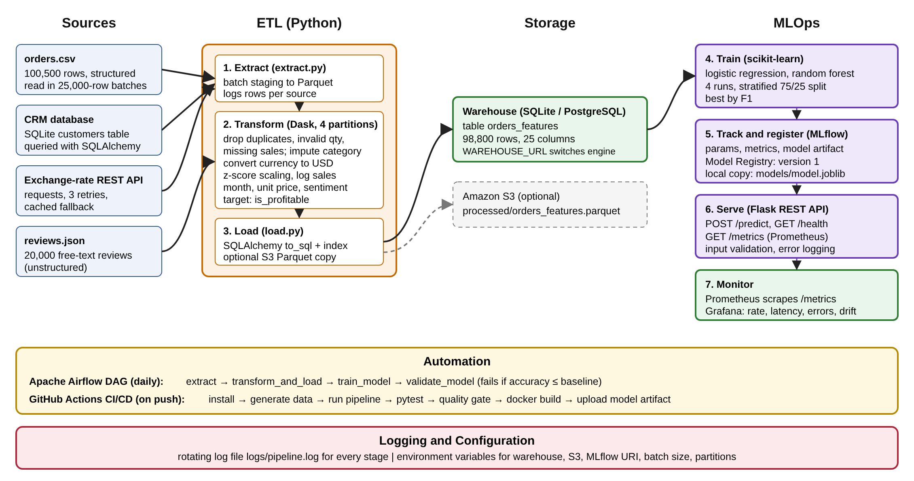

# Scalable ETL and MLOps Pipeline: Order Profitability

DDS-8530 Big Data Integration, Week 5. Author: C. Elizabeth Brignoni Brignoni.

An end-to-end pipeline that extracts retail order data from four sources, cleans and transforms it in parallel with Dask, loads it into a relational warehouse with SQLAlchemy, trains and tracks a profitability classifier with scikit-learn and MLflow, serves the model through a Flask REST API, and automates the whole flow with Apache Airflow and GitHub Actions. The API exposes Prometheus metrics for real-time monitoring in Grafana.

## Architecture



```
 Sources                     ETL (Python)                         MLOps
 ---------------------       ------------------------------       ------------------------------
 orders.csv (100k rows) -->  extract: CSV in 25k-row batches  
 crm_source.db (SQLite) -->  extract: SQLAlchemy query         -> transform (Dask, 4 partitions)
 FX rates REST API      -->  extract: requests + retry/cache      clean | normalize | features
 reviews.json (text)    -->  extract: JSON                     -> load (SQLAlchemy -> warehouse.db,
                                                                   optional S3 Parquet copy)
                                                                -> train (scikit-learn, MLflow
                                                                   tracking + model registry)
                                                                -> serve (Flask API: /predict,
                                                                   /health, /metrics)
 Orchestration: Airflow DAG (daily)   CI/CD: GitHub Actions   Monitoring: logs + Prometheus + Grafana
```

## Repository layout

| Path | Purpose |
| --- | --- |
| `scripts/generate_sources.py` | Builds the simulated source systems, including deliberate defects |
| `etl/extract.py` | Batch CSV extraction, SQLAlchemy database query, REST API call with retry and cached fallback, JSON reviews |
| `etl/transform.py` | Dask cleaning (duplicates, invalid quantities, missing values), currency normalization, z-score scaling, feature engineering, text sentiment features |
| `etl/load.py` | Writes the curated table to SQLite or PostgreSQL (`WAREHOUSE_URL`) and optionally to S3 (`S3_BUCKET`) |
| `pipeline/train.py` | Trains and tunes logistic regression and random forest models, logs runs to MLflow, registers the best model |
| `run_pipeline.py` | Runs extract, transform, load and train end to end |
| `api/app.py` | Flask model-serving API with Prometheus metrics and structured logging |
| `dags/etl_mlops_dag.py` | Airflow DAG with a model-quality gate |
| `.github/workflows/ci.yml` | CI/CD: install, run pipeline, test, quality gate, build Docker image, upload model artifact |
| `monitoring/` | Prometheus scrape config and provisioned Grafana dashboard |
| `tests/test_pipeline.py` | Unit tests for the transform and integration tests for the API |

## Quick start

```bash
python -m venv .venv && source .venv/bin/activate      # Windows: .venv\Scripts\activate
pip install -r requirements.txt
python scripts/generate_sources.py                      # create source data
python run_pipeline.py                                  # extract -> transform -> load -> train
pytest -v                                               # run tests
python -m api.app                                       # serve the model on http://localhost:5000
mlflow ui --backend-store-uri sqlite:///mlflow.db       # view experiments on http://localhost:5000 (use --port 5001 if the API is running)
```

Example prediction:

```bash
curl -X POST localhost:5000/predict -H "Content-Type: application/json" -d '{"category":"Technology","segment":"Corporate","region":"West","currency":"USD","discount":0.0,"quantity_z":0.4,"unit_price_usd_z":0.8,"log_sales_usd":7.2,"tenure_months_z":1.1,"loyalty_member":1,"review_sentiment":2,"has_review":1,"order_month":11}'
```

## Orchestration (Airflow)

```bash
pip install -r requirements-airflow.txt   # see the constraint note in the file
export AIRFLOW__CORE__DAGS_FOLDER=$(pwd)/dags
airflow standalone                         # UI on http://localhost:8080, DAG: etl_mlops_pipeline
```

## Monitoring (Prometheus and Grafana)

```bash
docker compose up --build
# API http://localhost:5000 | Prometheus http://localhost:9090 | Grafana http://localhost:3000 (admin/admin)
```

The Grafana dashboard tracks request rate, p95 prediction latency, error rate and the predicted-class mix, a simple signal of data drift.

## Results (latest run)

| Stage | Result |
| --- | --- |
| Extract | 100,500 order rows (4 batches), 5,000 customers, 20,000 reviews, FX rates |
| Transform | 500 duplicates, 200 invalid quantities and 1,000 missing sales removed; 495 categories imputed |
| Load | 98,800 rows in `warehouse.db` table `orders_features` |
| Best model | Logistic regression (C = 0.1): accuracy 0.906, F1 0.939, ROC AUC 0.960, vs. 0.747 majority baseline |

## Deployment status

| Component | Status |
| --- | --- |
| ETL, training, MLflow tracking, Flask API, tests | Executed locally and in GitHub Actions |
| GitHub Actions CI/CD | Running on every push |
| Airflow DAG | Configured; run with the Airflow commands above |
| Prometheus and Grafana | Configured; start with `docker compose up` |

## Configuration

| Variable | Default | Use |
| --- | --- | --- |
| `WAREHOUSE_URL` | `sqlite:///data/warehouse.db` | Point to PostgreSQL in production |
| `S3_BUCKET` | unset | Copy the curated Parquet file to S3 |
| `MLFLOW_TRACKING_URI` | `sqlite:///mlflow.db` | Remote MLflow server |
| `CHUNK_SIZE` | `25000` | Extraction batch size |
| `DASK_PARTITIONS` | `4` | Parallelism for the transform |

Data note: the source data is synthetic and generated with a fixed seed (8530) so every run is reproducible.
